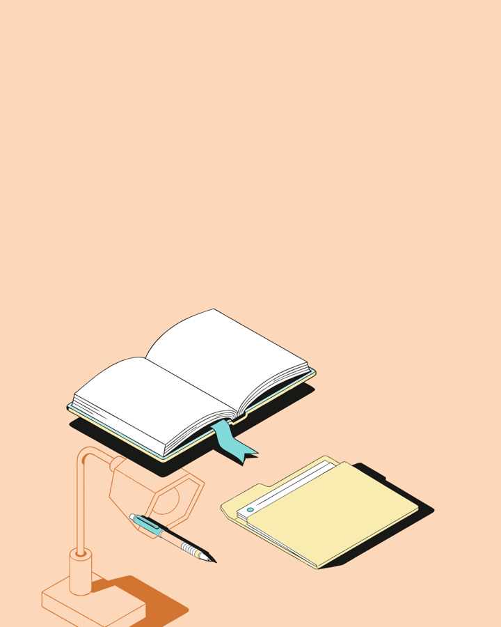

# Конструктор иллюстраций

**[Открыть демоверсию](https://violettancl.github.io/illustration-composer/)** · [Краткая демонстрация и проверка](docs/DEMO.md) · [Примеры SVG](examples/compositions/)

## Видеодемонстрация

[Смотреть или скачать видео (MP4)](docs/media/illustration-composer-demo.mp4) — короткая запись реального интерфейса без озвучки: сборка по запросу, редактирование объектов, слои, загрузка палитры и экспорт SVG. [Инструкция для самостоятельной проверки](docs/DEMO.md).

Демо работает без регистрации и API-ключа: откройте ссылку и нажмите «Собрать».

Веб-сервис собирает изометрические иллюстрации из готовой библиотеки векторных
объектов: 10 объектов × (главный / фоновый) × (размер L / S) = **40 исходных SVG-компонентов**.
Новые объекты сервис не создаёт. Каждая композиция состоит только из исходных контуров:
их можно переставлять и поворачивать, а перекрашиваются они только по ролям цветовой схемы.


## Что умеет

| Требование ТЗ | Как сделано |
|---|---|
| Сценарий 1: метафора или заголовок → композиция | Офлайн-словарь смыслов (основы слов на русском + английские слова) или, при наличии ключа, Claude выбирает объекты из каталога. Затем объекты автоматически раскладываются на холсте |
| Сценарий 2: названия компонентов → композиция | «книга, телефон, 2 монеты, фоновые наушники». Распознаются падежи, количество и признак «фоновый» |
| Работа с SVG-библиотекой | Готовая библиотека из 40 SVG, извлечённых из исходного Figma-файла. Свои SVG можно загрузить кнопкой «Загрузить SVG» |
| Векторная структура, цвета и пропорции сохраняются | Контуры (`d`) копируются в экспорт без изменений, это проверяется сравнением строк. Масштаб один на всю сцену |
| Добавить, переместить, повернуть, дублировать, удалить | Мышью и с клавиатуры (стрелки, Delete, Ctrl+D, Shift — шаг поворота 15°) |
| Порядок слоёв, сцена из разных исходных иллюстраций | Панель «Слои», клавиши `[` `]`, переключатель «главный ↔ фоновый» |
| Выбор размера | L (детально) / S (упрощённо). Объекты подменяются автоматически, их визуальный размер не меняется |
| Выбор цветовой схемы | 3 исходные схемы и свои: можно загрузить файлом JSON / SVG / текстом или собрать вручную из 8 цветов |
| Автоматическая перекраска | Замена hex по ролям, сразу на холсте и в экспорте |
| Экспорт SVG | Векторный файл: каждый объект — отдельная группа `<g id="book-main-1">`. Открывается в Figma и Illustrator |
| Разные форматы | 1200×630, 1:1, 4:5, 3:4, 16:9, 9:16 и произвольный. Под каждый формат композиция собирается заново |
| Варианты композиций | Три стиля из ТЗ («Собранно», «Со смещением», «Под заголовок») и 4 альтернативные раскладки по клику |
| Undo / redo, сохранение сцены | История на 100 шагов, сцена сохраняется в JSON и открывается из него |

## Запуск

```bash
npm install
npm run dev        # http://localhost:5173
npm run build      # статическая сборка в dist/
npm run preview    # просмотр сборки
```

Сервер не нужен: сборка — статический сайт. Её можно выложить на GitHub Pages (workflow лежит в
`.github/workflows/deploy.yml`), Vercel, Netlify или в любой S3-бакет.

### ИИ-анализ метафор (необязательно)

Без ключа работает офлайн-словарь. Чтобы метафору разбирал Claude, вставьте ключ Anthropic API
в разделе «ИИ-анализ метафор». Ключ хранится только в памяти вкладки до её перезагрузки; ранее сохранённый ключ удаляется. Запрос
идёт напрямую на `api.anthropic.com`.

Модель возвращает только id из каталога: допустимые значения жёстко заданы через `enum` в
JSON-схеме ответа и ещё раз проверяются в коде. Поэтому придумать новый объект модель не может.
Если запрос к модели не удался, сервис переключается на офлайн-словарь и сообщает об этом.

## Проверка и безопасность

```bash
npm ci
npm test
npm run build
```

Браузерные проверки выполняются в GitHub Actions перед публикацией: сборка, редактор, загрузка палитры, экспорт и проверка импорта SVG. Для локального запуска браузерных тестов см. [инструкцию](docs/DEMO.md).

Пользовательские SVG ограничены статическими векторными элементами: скрипты, внешние ресурсы и неподдерживаемые элементы отклоняются, обработчики событий и стили удаляются. Исходная доверенная библиотека не меняется. Ключ API не сохраняется между перезагрузками; для реального общего AI-сервиса нужен защищённый серверный прокси, не требуемый для этого демо.

## Архитектура

```
 Figma-файл ──export SVG──▶ tools/source/*.svg (2 листа: L и S, все контуры «плоские»)
                                   │  tools/bbox.cjs      — bbox каждого элемента (headless Chromium)
                                   │  tools/cluster.py   — кластеризация элементов в объекты
                                   │  tools/extract.py   — 40 отдельных SVG + отчёт
                                   ▼
 public/library/*.svg  +  manifest.json (смыслы, варианты)  +  palettes.json (роли цветов)
                                   │
                   ┌───────────────┼────────────────────────┐
             src/library.js   src/palette.js           src/semantic.js / src/ai.js
          (загрузка и кэш)   (роли, перекраска,       (метафора / названия → объекты)
                              загрузка палитр)                     │
                   │               │                         src/layout.js
                   └──────▶ src/scene.js ◀── src/editor.js   (автокомпозиция)
                           (модель сцены, экспорт SVG)  (холст, drag, rotate)
```

### Хранение SVG-элементов

- **Один компонент — один файл** (`public/library/{object}_{main|bg}_{L|S}.svg`). Внутри лежат
  исходные контуры из Figma без изменений. `viewBox` — это плотный bbox объекта в координатах
  исходного листа, поэтому сохраняются и форма объекта, и его масштаб относительно соседей по листу.
- Все компоненты хранятся в канонической **фиолетовой** схеме: в них ровно 8 hex-цветов,
  по одному на роль.
- **`manifest.json`** — каталог объектов: id, название, смысл, ключевые слова (для разбора
  метафор и для промпта Claude) и 4 варианта с размерами. Собирается командой
  `npm run build:library` из `tools/build-manifest.mjs`.
- **`palettes.json`** — роли цветов (`bg1…bg4` — цвета фона, `obj1…obj4` — цвета объектов) и
  3 исходные схемы. Пользовательские схемы и SVG сохраняются в `localStorage`.

### Извлечение

Исходный Figma-экспорт «плоский»: 1 579 контуров без групп и id. Скрипт автоматически режет его
на объекты в четыре шага:

1. Headless Chromium вычисляет `getBBox()` каждого элемента листа.
2. Элементы с пересекающимися bbox (с допуском 15 px) объединяются через union-find.
3. Если в кластер попали соседние объекты, он делится по разрывам в порядке слоёв: Figma
   выгружает каждый объект непрерывной последовательностью контуров.
4. Мелкие обрывки присоединяются к ближайшему объекту. Затем объекты упорядочиваются по сетке
   листа и получают имена.

Результат проверен визуально (контрольный лист всех 40 компонентов). Итоговые цвета совпадают
с палитрой из файла.

### Переиспользование

- `Library.component()` при первом обращении загружает и разбирает SVG и кэширует его
  (`{viewBox, inner}`). Дальше одна и та же строка `inner` используется в превью библиотеки,
  на холсте, в мини-превью вариантов и в экспорте.
- Объект на сцене — это **ссылка, а не копия**: `{object, kind, cx, cy, rot}`. При рендере он
  превращается в `<g transform="translate · rotate · scale · translate(-центр)">…исходные контуры…</g>`.
- Сцена — обычный JSON. Поэтому undo/redo, сохранение и смена размера L/S и схемы ничего не
  пересчитывают в геометрии: подменяется только вариант компонента и таблица цветов.

### Цвет

Перекраска — замена hex по ролям: `#7864D7 (bg3) → #D27532` в персиковой схеме и так далее.
Соответствие ролей проверено на эталонных композициях SVG-drop из ТЗ: результаты совпадают.

Правило «цвета фонов можно использовать в объектах, цвета объектов в фонах нельзя» выполняется
по построению:

- фон холста — всегда `bg1`;
- фоновые (монохромные) объекты в исходниках используют только `bg1`/`bg3`;
- `obj*` встречаются только в главных объектах.

Панель схемы показывает результат проверки по текущей сцене.

Новую палитру можно загрузить четырьмя способами:

- JSON `{title, colors:{bg1…obj4}}`, пример — `examples/palettes/sunset.json`;
- JSON `{schemes:[…]}` с несколькими схемами;
- текст или список из 8 hex: сначала 4 цвета фона, затем 4 цвета объектов;
- SVG-блок палитры из Figma: 8 прямоугольников-образцов в две колонки, как на листе библиотеки.

### Автокомпозиция (`src/layout.js`)

- Главные объекты добавляются от крупного к мелкому. Для каждого перебирается ~64 позиции, в
  которых объект касается уже поставленного по «изометрическим» направлениям (30°, 150°, 210°,
  330°…). Лучшая позиция выбирается по оценке: близость пропорций группы к целевой области,
  штраф за сильное наложение и компактность.
- Затем вся группа вписывается в целевую область стиля **одним масштабом**. Пропорции объектов
  относительно друг друга не меняются, как требует ТЗ. Ни один объект не занимает больше
  половины кадра.
- Фоновые объекты ставятся тем же масштабом за группой. Им разрешено уходить за край кадра,
  но не заходить в место под заголовок.
- Глубина: фоновые объекты рисуются раньше главных. Внутри группы порядок задаётся нижним краем:
  что ниже на экране, то ближе к зрителю.
- Генератор случайных чисел детерминирован (seed): «Другой вариант» и мини-превью — это другие seed.

## Использованные ИИ-инструменты

- **Claude Code** (агент Anthropic в терминале). С его помощью написаны: пайплайн извлечения
  библиотеки из Figma-экспорта, код сервиса, автотесты в headless-браузере, README. Решения и
  результат проверялись вручную по скриншотам.
- **Claude API** — внутри сервиса, необязательно: разбор метафор в сценарии 1 (`src/ai.js`,
  модель `claude-opus-5-5`, ответ строго по JSON-схеме). Графику модель не генерирует.

- **ChatGPT** — дополнительный аудит кода, усиление безопасности, подготовка автоматических проверок и документации перед сдачей.

## Примеры собранных композиций

Все файлы лежат в `examples/compositions/`: SVG — результат экспорта, PNG — превью.

| | Запрос | Формат · размер · схема | Стиль |
|---|---|---|---|
|  | «Кэшбэк за каждую покупку» → кошелёк, монета + смартфон, фоновая папка | 1200×630 · L · фиолетовая | Собранно |
|  | «Готовимся к экзамену» → ручка + книга, папка, фоновая лампа | 1080×1350 · L · персиковая | Под заголовок |
|  | «Командная работа над проектом» → пазл + смартфон, книга, фоновая папка | 1080×1080 · S · мятная | Со смещением |
|  | Названия: «лампа, книга, ручка, фоновые цветы, фоновые наушники» | 1920×1080 · L · мятная | Собранно |

## Структура

```
public/library/        40 SVG-компонентов, manifest.json, palettes.json
src/                   приложение (vanilla JS + Vite, без фреймворка)
tools/                 извлечение библиотеки из Figma-экспорта, исходные листы
examples/source/       эталонные композиции из ТЗ (SVG-drop) — по ним сверены роли цветов
examples/compositions/ примеры, собранные сервисом
examples/palettes/     пример палитры для загрузки
```
